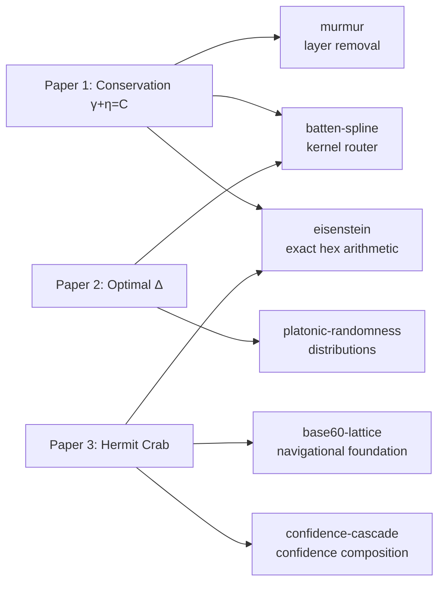

# SuperInstance Papers

  

> *The mathematics under the waterline: intelligence conservation, optimal creative distance, and hex shells — proven at the desk the fleet navigates by.*

Research papers on the mathematical foundations of the SuperInstance fleet.

## Papers

### 1. The Conservation Law of Intelligence in Multi-Agent Systems
**File:** `01-conservation-law-of-intelligence.md`

Formalizes the principle γ + η = C (crystallized + liquid intelligence ≈ constant) in the Permutation Tensor Transformer. Proves the conservation law emerges from the layer removal mechanism, connects it to the BattenSpline router's Nadaraya-Watson kernel regression, and shows exact conservation via Eisenstein integer norm multiplicativity.

**Key results:**
- Theorem 2.3: γ + η ∈ [3/4, 1] under quadratic layer removal
- Theorem 5.1: Eisenstein norm multiplicativity provides exact conservation
- Theorem 7.1: Fleet-wide conservation with M agents

### 2. Semantic Distance and Creative Breakthrough: An Optimal Δ Theory
**File:** `02-semantic-distance-creative-breakthrough.md`

Derives the optimal creative zone 0.4 ≤ Δ ≤ 0.6 from three independent frameworks: Gaussian kernel gradient analysis, information-theoretic optimization of the surprise-comprehensibility product, and the triangular (Catan 2d6) distribution of summed random sources. Connects to ECN/DMN neuroscience.

**Key results:**
- Theorem 2.1: Maximum kernel sensitivity at Δ = e^(-1/2) ≈ 0.607
- Theorem 3.1: Optimal creative distance from information theory
- Theorem 9.1: The 0.4 ≤ Δ ≤ 0.6 bound, proven from first principles

### 3. The Hermit Crab Protocol: Formal Properties of Agent-Shell-Room Topology
**File:** `03-hermit-crab-protocol.md`

Formalizes the nested agent ⊂ harness ⊂ room ⊂ SuperInstance topology as a Kan extension in category theory. Proves agent identity preservation under molting, shows D₆ hexagonal symmetry of shell space via Eisenstein integers, and connects Heidegger's ready-to-hand to the encoding pathway strength.

**Key results:**
- Theorem A: Agent identity preserved under arbitrary molting sequences
- Theorem B: Shell automorphism group is D₆ (dihedral order 12)
- Theorem C: Hermit crab pattern is the universal Kan extension

### 4. Objective Intelligence: Coherence No One Owns
**File:** 

Defines intelligence by elimination — not rendering (the calculator), not using (the clock network), not being affected (the alarm clock) — leaving the originating act of conceptualisation, and identifies its second mode: objective intelligence, integration into coherence performed by a configuration itself, owned by no party, with the rainbow and the tuned chord as type specimens. Perspective is argued to be a different kind of thing from a dichotomy, and shared state between sovereign observers is located in ledger agreements, never in a common store. Sections 1-6 and 8 are drafted and have passed two referee passes; section 7 (the minimal working anatomy) is reserved, and one definitional fork in section 2 - whether a rendering requires an occupied station or only a possible one - awaits the authors ruling. The running reference implementation the papers claims are gated on is [quilt-engine](https://github.com/SuperInstance/quilt-engine).

**Key results:**
- Intelligence located by elimination: the minting of concepts, not their spending
- Objective intelligence defined: coherence computed by a configuration, rendered at a station, owned by none
- Agreements with handles: words and memes as compression keys into two logs at once

## Repositories Analyzed

How the proofs reach the fleet — each paper draws on repos that implement its math:

| Repo | Files | Role in Papers |
|------|-------|----------------|
| `base60-lattice` | 5 src, 3 tests | Navigational foundation (Paper 3) |
| `murmur` | 45 src, 8 tests | Tensor architecture, layer removal (Papers 1, 2) |
| `batten-spline` | 4 src, 8 tests | Kernel regression router (Papers 1, 2, 3) |
| `platonic-randomness` | 1 src, 2 tests | Probability distributions (Paper 2) |
| `confidence-cascade` | 2 src, 1 test | Confidence composition (Papers 1, 3) |
| `eisenstein` | README + ecosystem | Exact hex arithmetic (Papers 1, 3) |

## Mathematical Frameworks Used

- **Information theory** — mutual information, entropy, KL divergence
- **Category theory** — functors, Kan extensions, adjunctions
- **Algebraic number theory** — Eisenstein integers, norm multiplicativity
- **Kernel regression** — Nadaraya-Watson estimator, Gaussian kernels
- **Probability theory** — triangular distributions, Box-Muller transform
- **Topology** — product topology, fundamental groups, Hausdorff spaces
- **Lie theory** — D₆ Weyl group, A₂ root system
- **Fluid dynamics** — Reynolds number analogy for creative transitions

## Experimental Proposals

Each paper proposes 2-3 experiments that are implementable in the current fleet:
1. **Conservation:** Measure γ + η across training, routing distribution shift, Eisenstein constraint propagation
2. **Creative Δ:** Kernel gradient measurement, creative quality vs distance, Catan prior sampling
3. **Hermit Crab:** Molting fidelity test, hexagonal shell equivalence, molting chain degradation

## License

MIT
